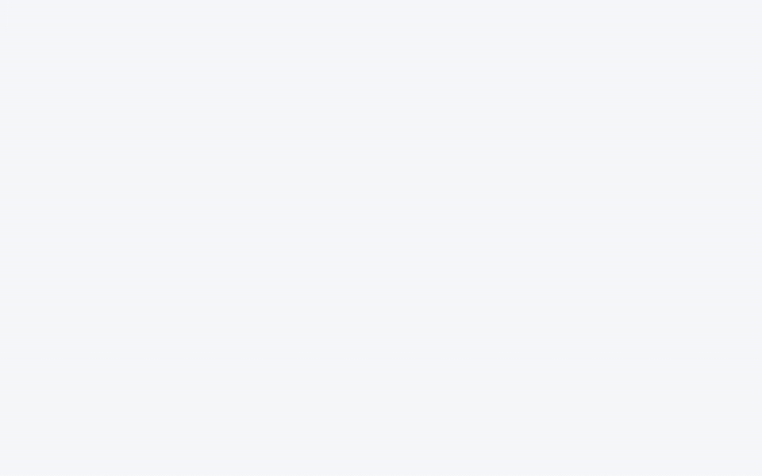
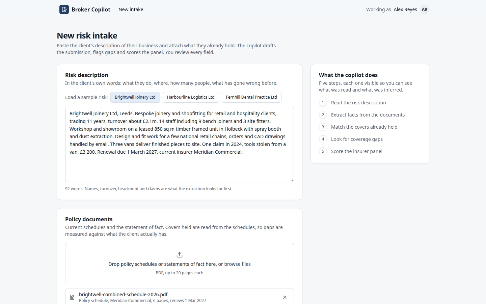
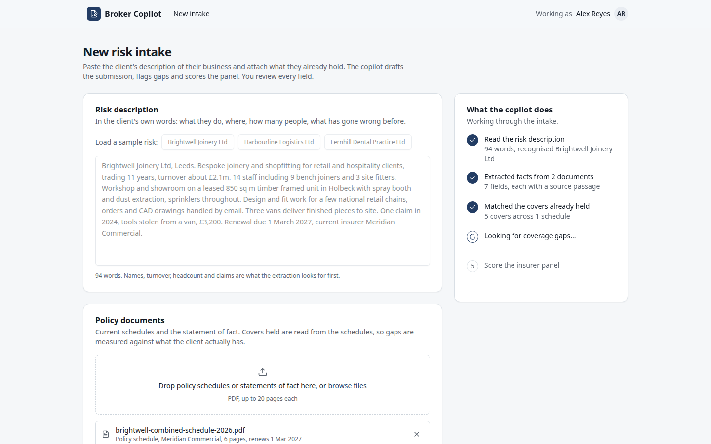
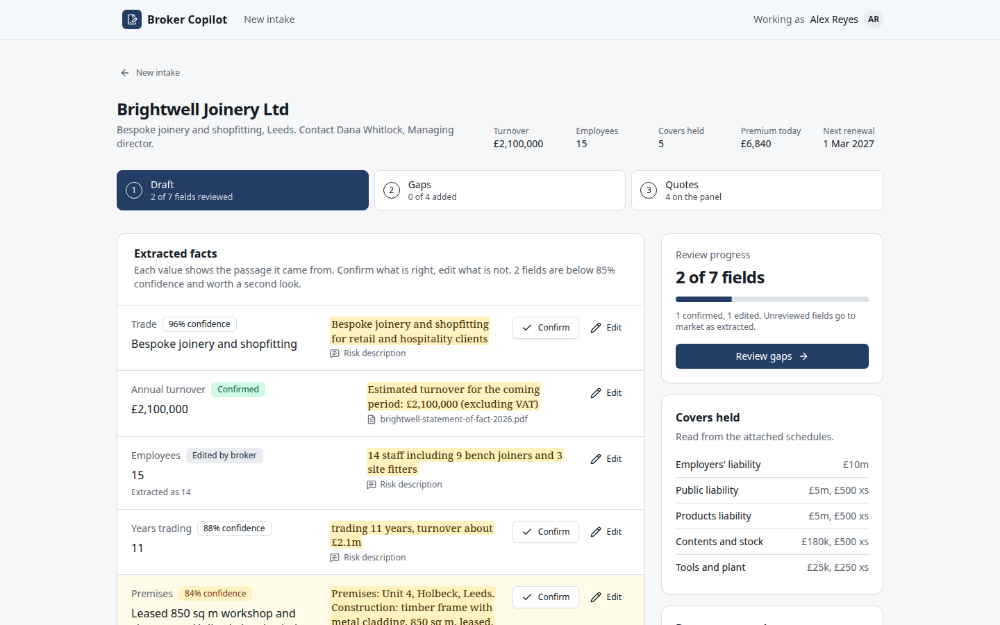
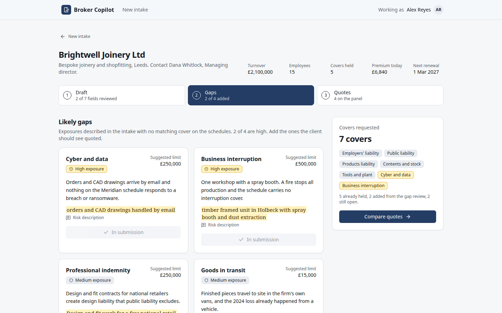
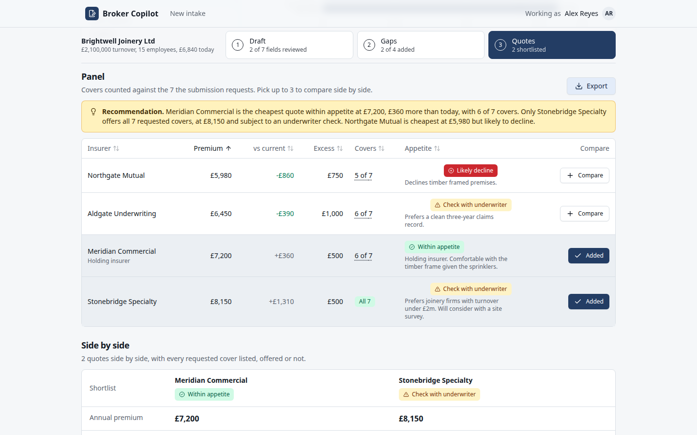

# Broker Copilot: risk intake to quote comparison

A broker pastes a client's risk description, attaches the current policy documents, and gets a reviewable submission draft, likely coverage gaps and a quote comparison across an insurer panel.



Live demo: https://neomaking.github.io/broker-copilot-demo/

## Why

Konsileo's October 2026 round is earmarked for putting AI into its own broking platform, and its CEO describes the goal as taking assembly work off brokers. Submission packs are the clearest case: reading what the client wrote, pulling facts out of schedules, retyping them for insurers. The platform already holds structured risk data, so a copilot that drafts the pack and shows its sources would sit on top of what exists.

## What's inside

- Three fictional UK clients, each with a schedule, a statement of fact, canned extraction output and four insurer quotes, parsed through Zod.
- Every figure on screen comes from one selectors module and is checked by an invariants test, so the header, the draft and the export cannot disagree.
- Intake recognition and submission edits are Effect services with typed failures: unknown client, no documents, a schedule for the wrong client, a full shortlist.
- Insurer appetite is a small rule engine (fleet size, turnover, claims, construction) that scores each quote.
- tRPC v11 runs in the browser behind a local link, so the site is static.

## Screenshots







## Run locally

```
npm install && npm run dev
```

## Tests

```
npm run qa
```

This runs typecheck, Biome, Vitest, the production build, Playwright and the media export.

Unit tests cover the appetite rules, the intake and submission rules (every typed failure has a test), the quotes table (sorting, shortlist toggling) and the fixture invariants: premiums in range, gaps never duplicating a held cover, draft values equal to the client facts, pipeline step counts equal to what the screens show, and the export repeating the on-screen figures.

The e2e walks five states at 1440x900 (intake, analysis in progress, draft review with a confirm and an edit, gap flags, quote shortlist and export) and asserts the counts in the step rail after each action. A second spec checks that every screen fits a 390px viewport without horizontal overflow.

## Notes

- A production version would call a model with the documents and the pasted text, return the same typed shape, and keep the source passage per field so the broker can verify each value against the page it came from.
- Appetite rules would come from each insurer's published guides and the broker's own placement history, with versioning, rather than from a fixture.
- Exports would go into the client file and the insurer submission format instead of Markdown, and edits would be audited per field.

Independent concept, not affiliated with or endorsed by Konsileo. No proprietary data was used. Built by [Valentin Szczupak](https://github.com/NeOMakinG).
